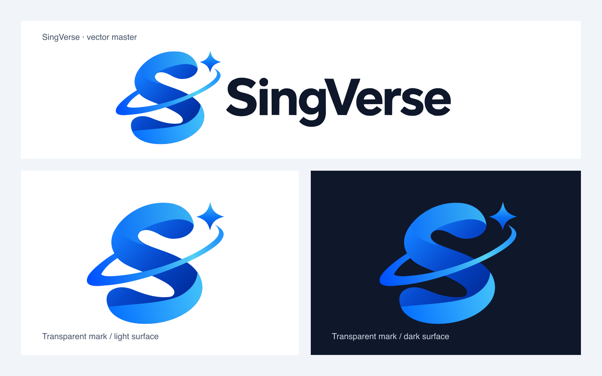

# SingVerse 项目标识

设计日期：2026-11-09。主体由蓝色的 **S 声波丝带、星轨和一枚四角星**组成，呼应 SingVerse 的名字与家庭 KTV 定位。色彩参考现有管理端的蓝色和深石板色；字标使用准确大小写 `SingVerse`。

2026-11-12 清晰度修复：保留原有标识与字标轮廓，将标志重建为平滑贝塞尔曲线、字标转为轮廓，清除原始 PNG 透明区域中的蓝色杂点。SVG 是当前品牌源文件；网页与支持渐变矢量的 Android 直接绘制路径，PNG 只作为按用途生成的兼容资源。



## 素材清单

| 文件 | 实际尺寸 | 用途 |
|---|---|---|
| [singverse-logo-mark.svg](singverse-logo-mark.svg) | 矢量，viewBox 1254 × 1254 | 独立标志的权威源文件，透明底、连续渐变、无位图与字体依赖 |
| [singverse-wordmark.svg](singverse-wordmark.svg) | 矢量，viewBox 2172 × 724 | 原有 `SingVerse` 字标的轮廓源文件 |
| [singverse-logo-horizontal.svg](singverse-logo-horizontal.svg) | 矢量 | 标志与轮廓字标组成的横版组合 |
| [singverse-app-icon-master.svg](singverse-app-icon-master.svg) | 矢量 | 深色底、完整方形应用图标 |
| [singverse-tv-banner.svg](singverse-tv-banner.svg) | 矢量，viewBox 320 × 180 | 白底 TV 桌面横幅，按实际显示尺寸绘制 |
| [singverse-logo-mark.png](singverse-logo-mark.png) | 2048 × 2048 | 从矢量直接渲染的透明底兼容图 |
| [singverse-logo-horizontal.png](singverse-logo-horizontal.png) | 4344 × 1448 | 从矢量直接渲染的横版兼容图，适合浅色背景 |
| [singverse-app-icon-master.png](singverse-app-icon-master.png) | 2048 × 2048 | 深色底、完整方形应用图标兼容图 |
| [icons/icon-1024.png](icons/icon-1024.png) | 1024 × 1024 | 通用高分辨率打包图标 |
| `icons/icon-{尺寸}.png` | 16、32、48、64、72、96、128、144、180、192、256、512、1024 | 从同一矢量源按目标尺寸抗锯齿渲染的 PNG |
| [favicon.ico](favicon.ico) | 内含 16、32、48 三档 | 浏览器或支持 ICO 的打包工具 |
| [singverse-tv-banner.png](singverse-tv-banner.png) | 320 × 180 | 同一横版 Logo 在白色底上的 TV 桌面横幅 |
| `icons/logo-mark-{尺寸}.png` | 128、512 | 供只接受 PNG 的场景使用的透明派生图 |
| [singverse-brand-preview.png](singverse-brand-preview.png) | 1600 × 1000 | 横版组合及透明标志在浅色、深色背景上的展示图 |

这些文件是多端共用的品牌源素材，已接入手机 APK、Android TV 和管理平台的构建资源；正常打包会包含相应图标。各工程保存独立的派生资源，构建与部署不需要读取根目录素材，也不依赖图像生成工具。

## 已接入的位置

| 工程 | 使用位置 | 构建资源 |
|---|---|---|
| 手机 APK | 系统启动图标与圆形图标，Android 8+ 使用矢量自适应前景和深色背景 | 手机仓库 `android/app/src/main/res/` 下的 `mipmap-*`、`drawable-anydpi-v24/singverse_logo_mark.xml` 和相关 XML |
| Android TV | 系统图标、矢量桌面横幅、应用内品牌标识；API 23 保留 PNG 回退 | TV 仓库 `app/src/main/res/` 下的 `drawable-anydpi-v24/`、`drawable-nodpi/`、`drawable-xhdpi/` 与 `mipmap-*` |
| 管理平台与亲友 H5 | 浏览器图标、添加到主屏幕图标、管理登录页与侧栏、H5 顶部标识 | `public/assets/brand/`，随完整 `dist` 交给 Go 仓库嵌入平台镜像 |

修改品牌源图后，需要同步更新上述工程中的派生资源。分别在手机、TV 和前端仓库运行各自的构建入口；独立构建只使用所在仓库的资源。

## 使用约定

- 优先直接使用 SVG / Android VectorDrawable；需要 PNG 时从矢量源按目标尺寸渲染，保持长宽比，不放大既有小图或拉伸横版 Logo。
- 应用图标保留完整方形与四角背景，圆角由目标平台处理。两个 Android 工程均设置了独立透明前景和深色背景，前景内缩 21% 以保留遮罩安全区；旧版系统继续使用对应密度的方形图标。
- Android 传统启动图标可分别取 48、72、96、144、192px 对应 mdpi、hdpi、xhdpi、xxhdpi、xxxhdpi。NAS、Web 或打包工具使用其要求的相应尺寸。
- 横版 Logo 使用深色字标，放在白色或浅色背景上。深色背景可使用独立标志或深色底应用图标。
- 色板参考：主蓝 `#2563EB`、亮蓝 `#60A5FA`、深蓝 `#1D4ED8`、深石板 `#0F172A`。Logo 的连续渐变以 SVG 中的色标为准，色板用于界面配色。
- 预览图仅用于展示，打包时选择独立图标文件。

## 生成与检查

最初的位图设计来自内置 `image_gen`，历史提示词保留在 [generation-prompts.md](generation-prompts.md)。当前源文件是独立标志和字标的 SVG；其他 SVG、PNG、ICO 与 Android XML 由 [export-brand-assets.mjs](../../scripts/export-brand-assets.mjs) 导出。PNG 先按目标尺寸的 2–4 倍渲染矢量，再以 Lanczos3 缩小，透明通道保留抗锯齿，不对旧 PNG 做放大。

素材维护工具需要 Node 与可解析的 `sharp` 模块（可通过 `NODE_PATH` 指向单独安装目录），正常应用构建不需要这些维护依赖。以下命令只更新前端仓库资源：

```sh
node scripts/export-brand-assets.mjs
```

跨仓库同步必须显式传入各自资源目录，未传入时不会查找或修改相邻仓库：

```sh
node scripts/export-brand-assets.mjs \
  --tv-res /path/to/singverse-tv/app/src/main/res \
  --mobile-res /path/to/singverse-mobile/android/app/src/main/res
```

Android 渐变矢量放在 `drawable-anydpi-v24/`，保持 TV minSdk 23；API 23 使用干净的 PNG。自适应图标通过 `<inset android:drawable="…">` 引用资源，使系统可以直接绘制矢量，不能再用 `<bitmap>` 包装矢量。TV 横幅的画布、比例及 xhdpi 160 × 90dp 逻辑尺寸保持一致。

检查项目包括 PNG 的实际尺寸、透明通道、透明区域杂点、应用图标不透明性、ICO 的三档内容，以及浅色背景、横版文字、小尺寸和 4K 渲染效果。Android 自适应前景仍内缩 21%；修改轮廓后需重新检查 108dp 画布上的 33dp 半径安全区。

以下为拆分前的历史检查记录，不代表当前构建或设备验收：多端接入曾通过 `make frontend-check`、前端登录/导航/亲友页面的 21 项现有行为测试、`make mobile-check mobile-build`、`make tv-build`，以及前端构建后的 `WebWelcomeTest,AdminWebTest` 四项隔离 HTTP 测试。另逐一核对了两份 debug APK 内五档传统图标与自适应资源、TV 横幅和完整前端 `dist` 中的品牌文件。手机、电视和 NAS 实机的启动器及显示效果仍需真机验收；本次构建结果不代表正式签名发布或远程 CI 已通过。
